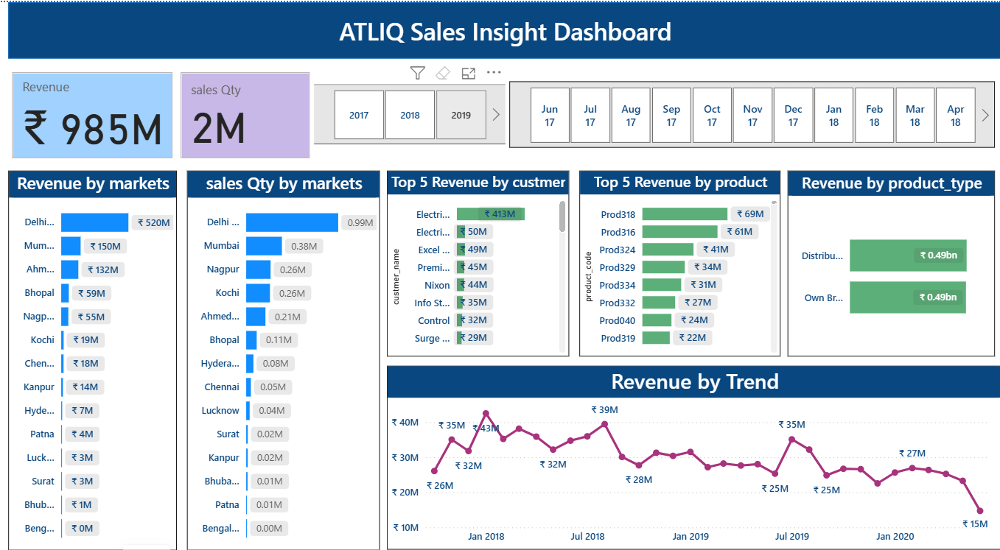
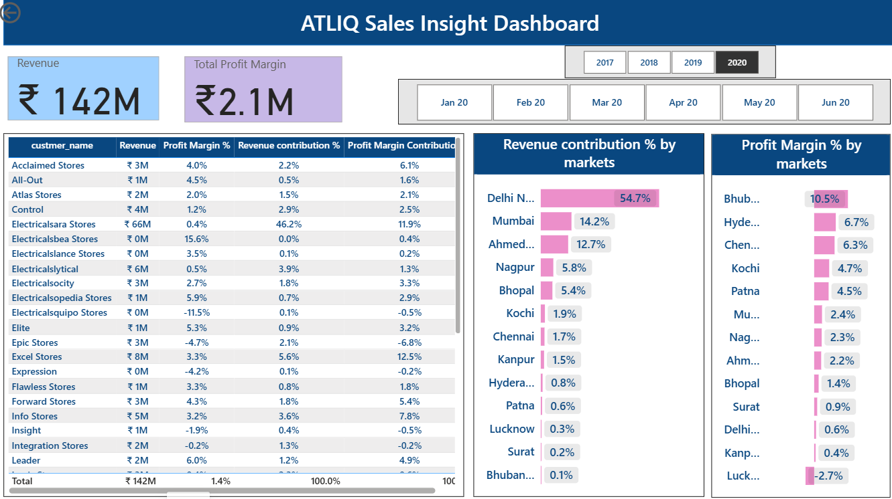

#  Sales Insights Dashboard

## Project Overview

The **AtliQ Sales Insights Dashboard** is a Power BI project developed to analyze sales performance, customer contribution, product performance, market-wise revenue, and profitability. The project uses sales transaction data along with customer, product, and market details to turn raw business data into meaningful insights.

The interactive report contains three dashboard pages: **Sales Insight**, **Key Insight**, and **Sales by Market**. It helps users monitor revenue and sales quantity, compare markets, identify top customers and products, and understand revenue contribution and profit margins.

## Project Objectives

- Analyze total revenue and sales quantity.
- Identify the markets generating the highest revenue.
- Find the top-performing customers and products.
- Compare sales quantity across different markets.
- Track revenue trends over time.
- Analyze revenue contribution and profit margin by market.
- Review customer-wise revenue and profitability.
- Use interactive year and month filters to explore sales data.

## Tools & Technologies

- **Microsoft Power BI** – Dashboard development and data visualization
- **Power Query** – Data cleaning and transformation
- **DAX** – Measures and calculations
- **Microsoft Excel** – Source data files

## Dataset Description

The project uses four Excel dataset files:

| File | Description |
|---|---|
| `Sales Transactions.csv.xlsx` | Main transaction table containing product, customer, and market codes, order date, sales quantity, sales amount, currency, profit margin, cost price, and normalized sales amount. |
| `Sales customers.csv.xlsx` | Customer details, including customer code, customer name, and customer type. |
| `Sales product.csv.xlsx` | Product details, including product code and product type. |
| `Sales market.csv.xlsx` | Market details, including market code, market name, and zone. |

### Dataset Size

- Sales Transactions: **148,395 records**
- Customers: **38 records**
- Products: **339 records**
- Markets: **17 records**
- Transaction date range: **October 2017 – June 2020**

## Dashboard Pages

### 1. Sales Insight Dashboard

**Key Performance Indicators (KPIs)**

- **Revenue:** Displays the overall revenue generated from sales.
- **Sales Quantity:** Shows the total quantity of products sold.

**Key Visualizations**

- **Revenue by Markets:** Compares revenue generated by each market.
- **Sales Quantity by Markets:** Displays the quantity of products sold in different markets.
- **Top 5 Revenue by Customer:** Highlights the five customers contributing the highest revenue.
- **Top 5 Revenue by Product:** Shows the top five products based on revenue.
- **Revenue by Product Type:** Compares revenue from Own Brand and Distribution products.
- **Revenue by Trend:** Displays how revenue changes over time.
- **Year and Month Slicers:** Filter the dashboard by selected years and months.

### 2. Key Insight Dashboard

**Key Performance Indicators (KPIs)**

- **Revenue:** Displays revenue for the selected period.
- **Sales Quantity:** Shows the total sales quantity.
- **Total Profit Margin:** Displays the profit margin amount.
- **Profit Target:** Allows the user to adjust the target value used in the report.

**Key Visualizations**

- **Revenue Trend:** Compares Revenue, Revenue LY (last year), and Profit Margin % over time.
- **Revenue Contribution % by Margin:** Shows market-wise revenue contribution and profit margin performance.
- **Customer Performance Table:** Displays customer-wise revenue, revenue contribution %, profit margin contribution %, and profit margin %.
- **Year and Month Slicers:** Help analyze performance for a selected period.

### 3. Sales by Market Dashboard

**Key Performance Indicators (KPIs)**

- **Revenue:** Displays revenue for the selected filters.
- **Total Profit Margin:** Shows the total profit margin amount.

**Key Visualizations**

- **Customer Performance Table:** Provides a detailed view of customer revenue and profitability.
- **Revenue Contribution % by Markets:** Compares each market's percentage contribution to total revenue.
- **Profit Margin % by Markets:** Compares profit margin percentages across markets.
- **Year and Month Slicers:** Allow users to filter market and customer performance by time period.

## Data Modeling

The Sales Transactions table is connected to the three lookup tables using their respective key columns:

- `Sales customers[customer_code]` → `Sales Transactions[customer_code]`
- `Sales product[product_code]` → `Sales Transactions[product_code]`
- `Sales market[markets_code]` → `Sales Transactions[market_code]`

The `order_date` field is used for time-based analysis and year/month filtering.

## Key Insights

The dashboards help users:

- Identify high-revenue markets and compare their sales quantity.
- Find the customers and products contributing the most revenue.
- Compare revenue from Own Brand and Distribution products.
- Track changes in revenue over the selected period.
- Understand how much each market contributes to total revenue.
- Identify markets with comparatively low or negative profit margins.
- Review customer-wise revenue and profitability.
- Explore sales performance using year and month filters.

## Project Structure

```text
AtliQ-Sales-Insights/
│
├── Sales Transactions.csv.xlsx
├── Sales customers.csv.xlsx
├── Sales product.csv.xlsx
├── Sales market.csv.xlsx
│
├── Insight_Dashboard.png
├── Key Insight.png
├── Sales_by_market.png
│
└── README.md
```

## Dashboard Screenshots

### 1. Sales Insight Dashboard



### 2. Sales Profit Dashboard




### 3. Performance Analysis Dashboard


## Final Conclusion

The AtliQ Sales Insights project uses Power BI to convert sales transaction data into interactive dashboards. It provides an overview of revenue, sales quantity, market performance, customer and product contributions, and profit margins. The three dashboard pages make it easier to explore sales trends, compare business performance, and identify areas that may need improvement. Overall, this project demonstrates the use of data cleaning, data modeling, DAX, and data visualization for business analysis.
